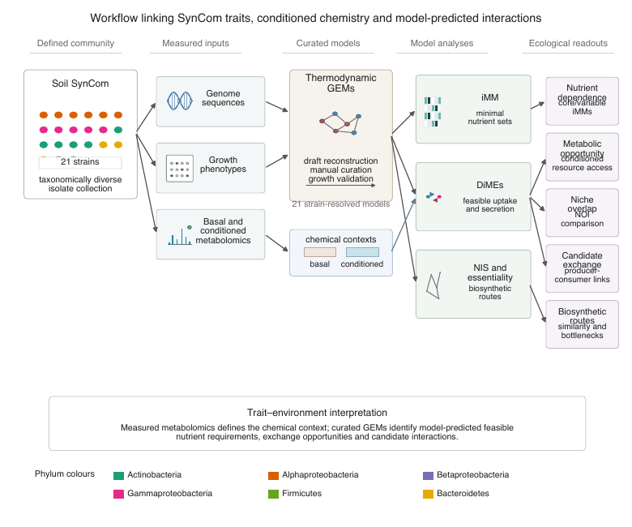

# SoilSynCom

We present the research code, experimental and computational data, curated
genome-scale metabolic models, and publication figures supporting our
manuscript **“Genome-scale metabolic models for a synthetic soil microbial
community as a path for understanding community functioning.”**

We use a species-resolved metabolic framework for a defined 21-member soil
synthetic community to study growth phenotypes, minimal nutrient requirements,
feasible uptake and secretion profiles, niche overlap, biosynthetic similarity,
gene essentiality, and candidate metabolic exchanges.

## Repository contents

| Path | Contents |
|---|---|
| [`data/`](data/) | Compact workflow inputs, processed analysis data, graphing workbooks, supplementary source tables, and package manifests |
| [`models/`](models/) | 80 final FBA and TFA models with checksums and validation summaries |
| [`code/reconstruction/`](code/reconstruction/) | Draft-model reconstruction and annotation code |
| [`code/model_curation/`](code/model_curation/) | Strain-specific, phenotype-guided, and shared model-curation code |
| [`code/thermodynamic_conversion/`](code/thermodynamic_conversion/) | FBA-to-TFA conversion workflows |
| [`code/analyses/`](code/analyses/) | iMM, DiMEs/NOI, NIS, and essentiality analysis materials |
| [`plotting/`](plotting/) | Manuscript notebooks and supplementary figure scripts |
| [`figures/`](figures/) | Main figures, supplementary figures, previews, and editable artwork |

## Data

We organize compact scientific inputs and publication datasets under
[`data/`](data/), with larger source data and computational assets in the
companion Zenodo package. Together they cover thermodynamic data, medium and
curation definitions, genome and protein FASTA files, analysis inputs,
experimental measurements, processed model analyses, and figure source data.

| Dataset group | Location | Contents |
|---|---|---|
| Workflow inputs | [`data/workflow_inputs/`](data/workflow_inputs/) | Compact thermodynamic annotations, media, curation tasks, DiMEs/iMM/NIS inputs, reconstruction metadata, and the GitHub/Zenodo checksum manifest |
| Growth phenotypes | [`data/graphing/ExperimentalGrowthData/`](data/graphing/ExperimentalGrowthData/) | PTYG and succinate growth measurements, BioLog plate-reader data, growth rates, and substrate-utilization summaries |
| Experimental validation | [`data/graphing/ExperimentalValidation/`](data/graphing/ExperimentalValidation/) | Growth-validation measurements and processed community experiments |
| Model properties | [`data/graphing/GEMStats/`](data/graphing/GEMStats/) | Genome-scale model statistics used in the manuscript figures |
| Minimal media | [`data/graphing/iMM/`](data/graphing/iMM/) | iMM solutions, nutrient identities, classifications, and summary statistics |
| DiMEs and niche overlap | [`data/graphing/DiMEs/`](data/graphing/DiMEs/) | Compound classifications, uptake/secretion profiles, conditioned-media results, and NOI matrices |
| Biosynthetic similarity | [`data/graphing/NIS/`](data/graphing/NIS/) | Pairwise similarity matrices for amino acids, cofactors, lipids, and nucleotides |
| Gene essentiality | [`data/graphing/GeneEssentiality/`](data/graphing/GeneEssentiality/) | Categorized essential-gene results for rich PTYG and M9 conditions |
| Curation | [`data/graphing/Curation/`](data/graphing/Curation/) | Gap-filling and model-curation source tables |
| Supplementary material | [`data/supplementary/`](data/supplementary/) | Source data for Supplementary V5 and Supplementary Table S1 |

The data are supplied as MAT, FASTA, XLSX, ODS, CSV, TSV, JSON, and Newick
files. [`input_manifest.tsv`](data/workflow_inputs/input_manifest.tsv) records
the role, package, package path, original archive location, size, and SHA-256
checksum of every workflow input.

The [`companion archive manifest`](data/companion_archive_manifest.tsv) and
[`collection index`](data/companion_archive_collections.tsv) catalogue the
Zenodo package: genome and protein sequences, raw experimental workbooks, the
full thermodynamic database, essentiality inputs, generated-analysis assets,
and source indexes for provider-managed reconstruction and gap-filling data.

## Final model collection

We provide four MATLAB `.mat` model families:

| Medium | Formulation | Folder | Models |
|---|---|---|---:|
| Rich PTYG | FBA (short) | `models/final/rich/FBA_short` | 21 |
| Rich PTYG | TFA (long) | `models/final/rich/TFA_long` | 21 |
| M9 | FBA (short) | `models/final/M9/FBA_short` | 19 |
| M9 | TFA (long) | `models/final/M9/TFA_long` | 19 |

For the M9 collection, `cxy` and `lur` use xylose as their carbon source. The
[`model manifest`](models/model_manifest.tsv) records the strain, medium,
carbon source, formulation, dimensions, and SHA-256 checksum of every model.
The [`validation summary`](models/VALIDATION.md) describes the annotation and
gene-reaction consistency checks applied to the complete collection.

## Code and software

We organize the MATLAB, Python, and R code by scientific task. Reconstruction
and curation scripts produce the strain-resolved GEMs; thermodynamic-conversion
scripts construct the TFA formulations; the analysis modules implement iMM,
DiMEs, niche-overlap, and NIS calculations; and the plotting notebooks connect
the study datasets to the manuscript figures.

The MATLAB helper [`soilSynComPaths.m`](code/soilSynComPaths.m) resolves the
repository and Zenodo data folders and reads workstation-specific software
locations from environment variables. `SOILSYNCOM_ARCHIVE_ROOT` identifies an
extracted copy of the companion data package.

The workflows use MATLAB, RAVEN, COBRA Toolbox, matTFA, ReMIND, redGEM/redGEMX,
NIS, NICEgame, CPLEX, and Gurobi. Python figure code uses NumPy, pandas, SciPy,
Matplotlib, Seaborn, Biopython, ETE Toolkit, openpyxl, and XlsxWriter. Links and
attribution information are provided in [`NOTICE.md`](NOTICE.md).

## Figures

- [`figures/main/`](figures/main/) contains the eight manuscript figures as
  publication PDFs with PNG previews.
- [`figures/supplementary/`](figures/supplementary/) contains all 31
  Supplementary V5 sheets in PDF, SVG, and PNG.
- [`figures/additional/`](figures/additional/) contains the scientific graphs
  and editable artwork associated with the project analyses.

## Citation

Please cite the accompanying manuscript when using these models, data, or
scripts. The complete author order and machine-readable citation metadata are
provided in [`CITATION.cff`](CITATION.cff).

## License and contact

We distribute the first-party software under the
[GNU General Public License v3.0 only](LICENSE). Software dependencies and data
resources retain their respective licenses and terms.

For questions about the project, please contact Vassily Hatzimanikatis at
<vassily.hatzimanikatis@epfl.ch>.
